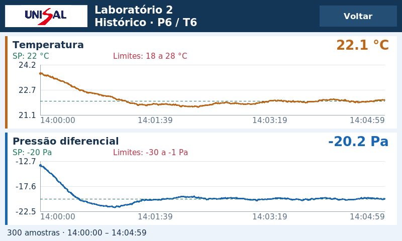

# TCC NB3 — interface 0.3.0

Interface para Raspberry Pi 3B com Raspberry Pi OS 64 bits e Arduino Mega 2560.

A versão 0.3.0 amplia as leituras da planta para 20 pontos em 800×480, usa fontes maiores nos formulários e oferece botões e setas de rolagem maiores. Pressão e temperatura aparecem em linhas separadas. A tela de histórico apresenta os dois gráficos, valores atuais, horários, setpoints e limites.

- [Imagem dos gráficos do Laboratório 2](imagens/graficos-laboratorio-2.png)
- [Imagem da planta com fontes ampliadas](imagens/planta-fontes-ampliadas.png)
- [Baixar o pacote completo](https://github.com/Gbeck1/TCC/raw/refs/heads/entrega-nb3/pacotes/tcc-nb3-raspberry.zip)



## Atualizar uma instalação existente

Feche o programa na Raspberry Pi. Extraia o ZIP numa pasta separada, faça uma cópia de segurança da pasta raspberry instalada e copie a nova pasta raspberry para dentro de /home/beck/TCC-NB3, substituindo os arquivos correspondentes. Reabra pelo ícone. A pasta raspberry precisa conter tcc_monitor; não crie raspberry/raspberry.

Preserve a .venv e ~/.local/share/tcc-monitor, onde estão usuários, históricos e configurações locais. O firmware do Arduino é o mesmo da entrega anterior: esta atualização visual não exige recompilar ou gravar o Mega. As imagens estão também na pasta imagens dentro do pacote.

Em telas de até 1024×600, a aplicação abre em tela cheia. Sair continua no cabeçalho; Esc retorna à janela e F11 alterna tela cheia. Não há autostart.

## Instalação nova

Copie a pasta TCC-NB3 extraída para a pasta pessoal da Pi e execute como usuário normal:

```bash
cd ~/TCC-NB3
bash scripts/install_raspberry.sh
```

O instalador prepara a aplicação e o ícone; a gravação USB do Arduino é uma etapa separada. Os códigos-fonte, testes e instruções completas estão dentro do ZIP.

Confira SHA256SUMS para integridade. O pacote foi validado por instalação offline numa cópia isolada, os 261 testes passaram e os fluxos de manutenção e calibração foram verificados numa tela virtual de 800×480.
