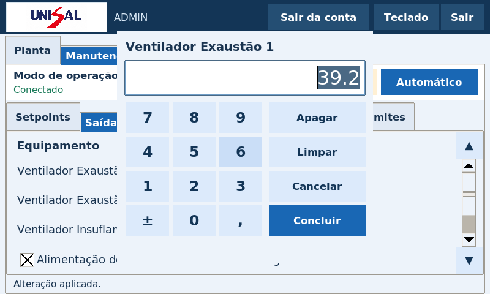
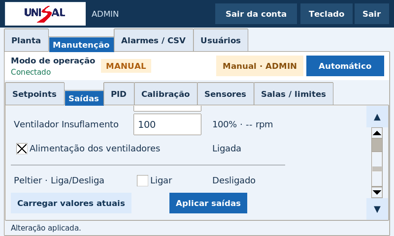

# TCC NB3 — versão 0.4.0

Atualização para Raspberry Pi 3B e Arduino Mega 2560: teclado numérico por toque e Peltier Liga/Desliga.

- [Baixar pacote 0.4.0](https://github.com/Gbeck1/TCC/raw/refs/heads/entrega-nb3/pacotes/tcc-nb3-0.4.0.zip)
- [Atualizar por SSH local](docs/update-0.4.md)
- [Sketch único para compilar no Arduino IDE](firmware/mega_controller/mega_controller.ino)
- [Firmware já compilado para Mega 2560](firmware/mega_controller.hex)

## Teclado por toque

Toque num campo numérico editável para abrir o teclado. Ele aceita vírgula decimal, sinal, Apagar e Limpar. Concluir preenche o campo, Cancelar preserva o valor anterior e Aplicar saídas envia os comandos. Os ventiladores continuam com PWM de 0 a 100%.

## Peltier Liga/Desliga

Na manutenção, marque/desmarque Ligar e use Aplicar saídas. O estado recebido do Arduino aparece separado. O comando não usa percentual de PWM.

No automático, o Peltier usa a média dos seis sensores: liga acima do setpoint + 0,5°C, desliga ao atingir o setpoint e mantém o estado dentro dessa banda. O PID ajustável continua sendo o da pressão P6. Sem média válida, a saída anterior é mantida, sem acrescentar desligamento ou intertravamento.

Atualize a aplicação da Pi e grave o novo firmware do Mega para alterar também o automático. O pacote inclui a fonte e o HEX compilado; não há gravação automática durante a instalação da interface. O formato EEPROM v2 foi preservado, mantendo as calibrações e associações salvas. A instalação existente informada está em /home/beck/Desktop/TCC-NB3. As instruções de SSH usam o nome local .local da Pi e transferência pelo cabo de rede, sem precisar de internet na Raspberry.

## Gráficos e leitura em 7 polegadas

[Imagem dos gráficos do Laboratório 2](imagens/graficos-laboratorio-2.png) · [Planta com fontes ampliadas](imagens/planta-fontes-ampliadas.png).

A interface mantém as fontes ampliadas e os controles por toque da versão 0.3.0. Os códigos, bibliotecas Python para instalação offline, documentos e testes estão no ZIP. Nenhuma senha SSH ou banco pessoal foi incluído. Confira SHA256SUMS.

Validação: 279 testes; fluxos gráficos em Tk 8.6/800×480; captura, aplicação e gravação da calibração; 321 verificações nativas sobre o sketch; compilação AVR para ATmega2560. O HEX usa 24.166 bytes de flash e 5.311 bytes de SRAM estática. Nenhuma gravação ou medição em placa física foi executada na nuvem.
