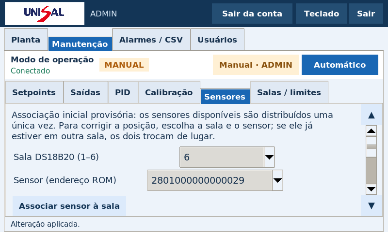

# TCC NB3 — versão 0.5.0

Associação provisória dos sensores de temperatura e melhoria do acesso à USB, mantendo o teclado numérico e o Peltier Liga/Desliga.

- [Baixar pacote 0.5.0](https://github.com/Gbeck1/TCC/raw/refs/heads/entrega-nb3/pacotes/tcc-nb3-0.5.0.zip)
- [Atualizar por SSH local](docs/update-0.5.md)
- [Alimentação e desconexões USB](docs/usb-power.md)
- [Sketch único para Arduino IDE](firmware/mega_controller/mega_controller.ino)
- [Firmware compilado para Mega 2560](firmware/mega_controller.hex)

## Sensores provisórios

Na partida, o Mega distribui de forma pseudoaleatória os DS18B20 encontrados entre as salas ainda sem sensor configurado. Cada ROM é única e o vínculo é salvo uma vez na EEPROM v2. A associação permanece nas próximas partidas e reconexões. Sensores já configurados conservam suas salas, mesmo quando temporariamente desconectados. Se houver menos de seis dispositivos detectados, apenas as leituras reais disponíveis são mostradas.

A associação inicial é provisória e não confirma a localização física. Depois, entre como ADMIN no modo Manual e use Manutenção → Sensores para escolher a sala e o endereço correto. Se o endereço pertence a outra sala, os dois trocam de lugar, preservando a unicidade e os demais parâmetros. Use Gravar configuração no Arduino para persistir a correção.

## Conexão e alimentação

Avisos de Undervoltage detected e USB disconnect exigem verificar a alimentação de 5 V na Raspberry, cabos, conectores e consumo da tela/periféricos. A potência nominal total de uma fonte não garante tensão estável na entrada da Pi. Estabilize a alimentação antes de gravar firmware ou salvar configurações. A versão nova solicita acesso exclusivo à porta serial no Linux e mostra o estado completo em Sensores; essas mudanças não corrigem uma queda elétrica de tensão.

O protocolo continua v2 e a estrutura EEPROM v2 foi mantida, preservando as calibrações salvas. O instalador não grava o Mega automaticamente. Atualize a aplicação da Pi e grave o novo firmware para ativar a associação inicial. As instruções usam o caminho existente informado, /home/beck/Desktop/TCC-NB3, e SSH pelo nome local .local da Pi.

## Recursos mantidos

[Gráficos do Laboratório 2](imagens/graficos-laboratorio-2.png) · [Planta ampliada](imagens/planta-fontes-ampliadas.png) · [Teclado numérico](imagens/teclado-numerico.png) · [Peltier Liga/Desliga](imagens/peltier-liga-desliga.png).

A interface mantém o tamanho de fonte para 7 polegadas. O teclado abre ao tocar nos campos numéricos; Concluir edita, Aplicar saídas envia e Cancelar preserva o valor anterior. O Peltier é Liga/Desliga nos dois modos, com média das seis temperaturas e histerese de 0,5°C no automático. O PID de pressão continua usando P6. Modo manual permanece sem timeout, watchdog ou intertravamento adicional.

Validação: 286 testes, 378 verificações nativas sobre o sketch, compilação AVR, interface Tk 8.6 em 800×480, instalação offline e roteiro de atualização a partir de 0.4.0. O HEX usa 25.034 bytes de flash e 5.317 bytes de SRAM estática. Nenhuma gravação ou medição em placa física foi feita na nuvem. Confira SHA256SUMS; os códigos completos e as dependências Python offline estão no ZIP.
