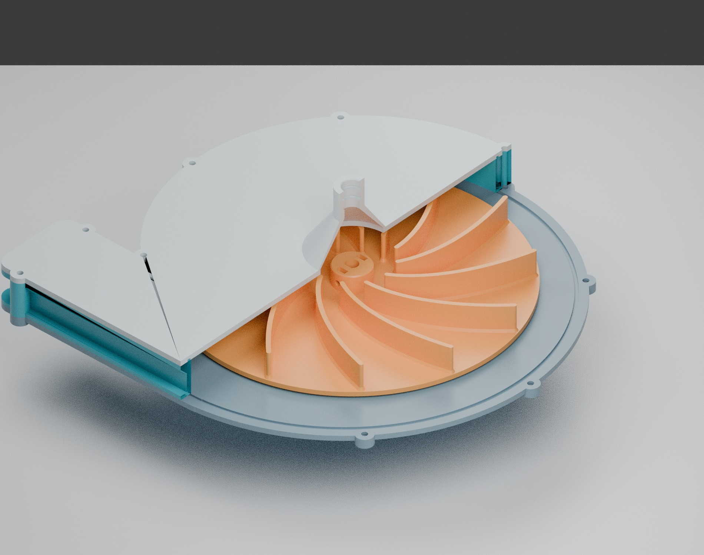

# Exaustor NB3 — protótipo centrífugo, 240 mm, horário

[Baixar pacote completo de STL e fonte CAD](pacotes/Exaustor_NB3_240_Horario_STL.zip?raw=true)

O pacote contém **11 STL**: quatro peças principais e sete gabaritos/testes de
encaixe. Para baixar um arquivo separado, abra a pasta [STL](STL) e use o botão
**Download raw file** do GitHub.



As cotas principais estão em [cotas do motor e montagem](imagens/cotas_motor_e_montagem.png).

Arquivos em **milímetros**. O sentido horário é visto de frente para a ponta do
eixo, olhando em direção ao motor. A sucção fica no centro da tampa; a descarga
com grade fica na lateral da voluta e deve permanecer livre para o ambiente.

O pacote modela as interfaces informadas nas fotos e no texto. As malhas e as
interferências de montagem foram verificadas em CAD. **O desempenho de pressão,
o aquecimento, a resistência à rotação e a contenção de fragmentos não foram
ensaiados.** A faixa de −80 a −60 Pa precisa ser confirmada na maquete com
sensores calibrados; o arquivo não oferece garantia de pressão.

## Imprimir primeiro os gabaritos

1. `05_gabarito_motor.stl`: conferir o ressalto de Ø 49,95 mm, altura de 2,5 mm
   e os quatro furos em círculo de Ø 64,5 mm. A rosca foi indicada como
   aparentemente M4 e deve ser confirmada sem forçar parafusos.
2. `06A/06B/06C`: testes do eixo em D. Diâmetro do eixo interpretado: 9,08 mm;
   medida do plano até a borda oposta: 8,08 mm. As folgas diametrais são,
   respectivamente, 0,20 / 0,30 / 0,40 mm. O rotor fornecido usa 0,30 mm.
3. `07A/07B/07C`: conferir os furos de 14,0 / 14,2 / 14,4 mm com o tubo real.
   **14 mm é o diâmetro externo do tubo**, conforme a última informação.
   A tampa usa um encaixe fêmea nominal de 14,2 mm e dois O-rings 14 × 2 mm.

O furo impresso deve entrar à mão. Se o ensaio exigir outra folga, ajustar os
parâmetros e regenerar o modelo antes de imprimir o rotor ou a tampa.

## Peças principais

- `01_placa_traseira.stl`: apoio no motor, alojamento do ressalto, vedação,
  rebaixos para as cabeças da fixação e porcas cativas da carcaça.
- `02_corpo_voluta_horario.stl`: câmara de coleta, flanges e grade de descarga.
- `03_tampa_succao_tubo14ext.stl`: tampa com cone de entrada e soquete fêmea.
- `04_rotor_240mm_horario.stl`: rotor aberto, com 12 pás curvadas para trás,
  cubo em D e alojamentos para dois parafusos radiais M4.

Os STL individuais estão orientados com a face de impressão em Z = 0. Imprimir
e montar cada componente separadamente. O rotor deve permanecer uma peça
independente, livre para girar. A fonte paramétrica em Python permite ajustar
a geometria; as instruções abaixo apresentam a sequência de montagem e as cotas.

## Material e montagem

Adotar **PETG** para este protótipo e verificar os limites térmicos do filamento
utilizado. PLA não foi adotado para o rotor funcional. Rotor: camada de 0,20 mm,
100% de preenchimento uniforme e pelo menos seis perímetros. Partes estáticas:
camada de 0,20 mm, pelo menos quatro perímetros e 35–50% de preenchimento. Os
valores são ponto de partida de fatiamento, não uma certificação de resistência.

Complementos previstos:

- 9 parafusos M4 × 40, 9 porcas travantes M4 e arruelas, para a carcaça;
- 4 parafusos compatíveis com os furos do motor e vedações sob suas cabeças;
  medir a profundidade real da rosca antes de escolher o comprimento;
- 2 parafusos sem cabeça M4 × 8 e 2 porcas M4 comuns para o cubo;
- 1 O-ring 54 × 2 mm no apoio do motor;
- 2 O-rings 14 × 2 mm na conexão do tubo;
- cordão/junta contínua de silicone de 2 mm nas duas interfaces da voluta;
- apoio para o conjunto e proteção de contenção adequada ao ensaio.

Ajustar o rotor para **2 mm de folga traseira**. A folga frontal nominal é de
1,5 mm; a radial é de pelo menos 3,5 mm. Conferir giro livre depois do aperto
uniforme da tampa. As cabeças da fixação ao motor devem ficar abaixo da face
interna da placa, com a vedação acomodada no rebaixo. Verificar fixação axial,
concentricidade e balanceamento antes de energizar. Não operar o rotor exposto.
Uma carcaça impressa não equivale a uma proteção ensaiada contra fragmentos.

A etiqueta do motor indica **110/220 V, 37 W, 1.650 rpm e 60 Hz**. Confirmar a
compatibilidade da ligação com a rede de 127 V e a proteção elétrica com pessoa
habilitada. Os MOSFETs e o PWM dos ventiladores de 12 V do projeto não acionam
diretamente este motor de rede.

## Pressão na maquete

A maquete informada totaliza aproximadamente 90 L. O tubo tem 350 mm de
comprimento e 14 mm externos; seu diâmetro interno ainda não foi informado.
Fugas, entradas de ar, registros e perdas de carga determinam a vazão necessária
para manter a pressão. O arquivo `calculo_preliminar.json` compara cenários de
diâmetro interno e vazão; não é uma curva medida do exaustor.

A faixa desejada de −80 a −60 Pa deve ser medida na sala de referência em relação
ao ambiente, sem usar a pressão junto ao bocal como substituta da pressão da
sala. Se a sucção ultrapassar a faixa, ajustar os registros ou uma sangria
regulável em T na sucção. A rotação deste motor não é regulada pelo PWM anterior.

## Fonte editável

O modelo é gerado por `cad/modelar_exaustor.py`, com parâmetros em
`cad/parametros.json`, usando Python, CadQuery, NumPy e SciPy. Para regenerar:

```bash
python cad/modelar_exaustor.py
```

Mantenha os STL de teste e o modelo principal com as mesmas compensações de
impressão. A opção de reutilização do B-Rep existe para revisão local de
exportação e não deve ser usada após modificar as dimensões.

Fonte dos desenhos: Acervo do autor. Projeto elaborado a partir das fotos e
medidas fornecidas pelo autor; os valores de escoamento são cálculos preliminares.
